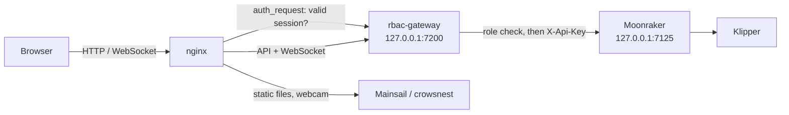

# Klipper RBAC Gateway

**A login screen and role-based access control for [Mainsail](https://github.com/mainsail-crew/mainsail) + [Moonraker](https://github.com/Arksine/moonraker) (Klipper).**

🇧🇷 [Leia em português](README.pt-BR.md)

Moonraker supports users, but every logged-in user can do everything — edit `printer.cfg`, run `SAVE_CONFIG`, restart the firmware, update the system. Mainsail, on the other hand, has no login screen for Moonraker users at all. This project fills both gaps with a small gateway that sits between nginx and Moonraker:

- 🔐 **Login screen before Mainsail loads.** Without a session, nothing is reachable: not the dashboard, not the API, not the webcam.
- 👥 **Three roles** (`viewer`, `operator`, `admin`), enforced on every API call and every WebSocket message.
- 🧩 **"Users" tab inside Mainsail's Interface Settings** for admins: create users, change roles, delete users.
- 🛡️ **Primary admin protection.** The first admin can never be demoted or deleted.
- 🧾 **G-code filtering.** Operators can only send allow-listed commands from the console, and uploaded `.gcode` files are scanned for dangerous commands.
- 📜 **Audit log.** Every login, denied action and user change is logged.

Mainsail itself is **not modified**. Updating Mainsail through the update manager keeps working.

---

## Table of contents

- [How it works](#how-it-works)
- [Roles](#roles)
- [Requirements](#requirements)
- [Installation](#installation)
- [Usage](#usage)
- [Configuration](#configuration)
- [Customizing permissions](#customizing-permissions)
- [Security notes and limitations](#security-notes-and-limitations)
- [Troubleshooting](#troubleshooting)
- [Uninstall / rollback](#uninstall--rollback)
- [Project structure](#project-structure)
- [License](#license)

---

## How it works



1. **nginx** asks the gateway (`auth_request`) on *every* request whether the browser has a valid session cookie. If not, it redirects to `/_rbac/login`.
2. After login, Mainsail loads normally. Its API and WebSocket traffic goes to the gateway instead of straight to Moonraker.
3. The **gateway** checks each HTTP request and each JSON-RPC message against the user's role. Allowed requests are forwarded to Moonraker using Moonraker's API key. Denied ones get a `403` error, which Mainsail shows as a notification.
4. **Moonraker** listens only on `127.0.0.1` and trusts no client, so the gateway cannot be bypassed from the network.
5. A small script (`ui.js`) is injected into Mainsail's page by nginx (`sub_filter`). For admins it adds the **Users** tab to the Interface Settings dialog; for everyone it shows who created each file/folder in the G-code list.

Users, password hashes (scrypt) and sessions are stored in the gateway's own SQLite database. Moonraker users are not used.

## Roles

| | Viewer | Operator | Admin |
|---|:---:|:---:|:---:|
| See temperatures, progress, webcam, history, files | ✅ | ✅ | ✅ |
| Emergency stop | ✅ | ✅ | ✅ |
| Start / pause / resume / cancel prints | ❌ | ✅ | ✅ |
| Upload files and create folders in `gcodes/` | ❌ | ✅ | ✅ |
| Move and delete **their own** files/folders in `gcodes/` | ❌ | ✅ | ✅ |
| Move and delete **anyone's** files/folders | ❌ | ❌ | ✅ |
| Console / buttons (allow-listed G-code only) | ❌ | ✅ | ✅ |
| Any G-code, macros not on the list, `SAVE_CONFIG`, restarts | ❌ | ❌ | ✅ |
| Edit `printer.cfg` and other config files | ❌ | ❌ | ✅ |
| Updates, reboot/shutdown, services | ❌ | ❌ | ✅ |
| Manage users (Users tab) | ❌ | ❌ | ✅ |

Emergency stop is available to everyone on purpose: anyone watching the printer should be able to stop it. You can change that (see [Customizing permissions](#customizing-permissions)).

## Requirements

- Klipper + Moonraker + Mainsail served by **nginx**. [MainsailOS](https://github.com/mainsail-crew/MainsailOS) works out of the box.
- Python **3.9+**.
- nginx with `ngx_http_auth_request_module` and `ngx_http_sub_module`. Both are included in Debian's / Raspberry Pi OS's nginx package.

Developed and tested on MainsailOS on a Raspberry Pi 4 (Python 3.13).

## Installation

> **Before you start:** steps 5 and 6 lock down Moonraker. Keep an SSH session open until you have confirmed you can sign in. The [rollback](#uninstall--rollback) takes seconds.

The commands below assume the user `pi` and the repository in `~/klipper-rbac-gateway`. Adjust them if yours differ.

### 1. Download and install dependencies

```bash
cd ~
git clone https://github.com/<your-github-user>/klipper-rbac-gateway.git
cd klipper-rbac-gateway
python3 -m venv venv
venv/bin/pip install -r requirements.txt
```

### 2. Store Moonraker's API key

Do this **before** locking down Moonraker. While the Pi is still a Moonraker trusted client, no credentials are needed.

```bash
venv/bin/python main.py apikey
```

Expected: `API key saved to /home/pi/printer_data/gateway/api_key` (file mode `600`).

### 3. Create the first admin (the primary admin)

```bash
venv/bin/python main.py create <your-name> admin
```

You will be asked for the password twice, and nothing is shown while typing. **This first admin becomes the primary admin**: its role can never be changed and it can never be deleted.

### 4. Install the service

```bash
sudo cp config/systemd/rbac-gateway.service /etc/systemd/system/
sudo systemctl daemon-reload
sudo systemctl enable --now rbac-gateway
journalctl -u rbac-gateway -n 5 --no-pager
```

Expected: `Uvicorn running on http://127.0.0.1:7200`. If your user is not `pi`, edit `User=` and the paths in the unit file first.

### 5. Lock down Moonraker

Back up and edit `~/printer_data/config/moonraker.conf`:

```bash
cp ~/printer_data/config/moonraker.conf ~/printer_data/config/moonraker.conf.bak
```

- In `[server]`, set `host: 127.0.0.1`.
- In `[authorization]`, add `force_logins: True` and **remove the whole `trusted_clients:` list**. Keep `cors_domains`.

The result should look like this:

```ini
[server]
host: 127.0.0.1
port: 7125
...

[authorization]
force_logins: True
cors_domains:
    ...
```

### 6. Point nginx at the gateway

```bash
# back up nginx config
sudo cp -r /etc/nginx/conf.d /etc/nginx/conf.d.bak
SITE=$(readlink -f /etc/nginx/sites-enabled/mainsail)
sudo cp "$SITE" "$SITE.bak"

# 1) API/WebSocket upstream -> gateway
sudo sed -i 's/127\.0\.0\.1:7125/127.0.0.1:7200/' /etc/nginx/conf.d/upstreams.conf

# 2) login + Users tab snippet, included at the top of Mainsail's server block
sudo cp config/nginx/rbac-auth.conf /etc/nginx/rbac-auth.conf
sudo sed -i '0,/^\s*server\s*{/s//&\n    include \/etc\/nginx\/rbac-auth.conf;/' "$SITE"

sudo nginx -t
```

On MainsailOS the upstream lives in `/etc/nginx/conf.d/upstreams.conf`. On other setups, find it with `grep -rn 7125 /etc/nginx/`. The webcam upstreams (ports 8080+) must **not** be changed.

If `nginx -t` reports `test is successful`, apply everything:

```bash
sudo systemctl restart moonraker
sudo systemctl reload nginx
```

### 7. Verify

```bash
curl -s http://127.0.0.1/access/info; echo            # -> "login_required":true,"trusted":false
curl -s http://127.0.0.1/_rbac/login | grep -o "_rbac/ui.js"   # -> _rbac/ui.js
```

Open Mainsail in the browser and press **Ctrl+F5**. The login screen should appear. Sign in, open **Interface Settings** (the gear icon), and the **Users** tab is at the end of the list.

## Usage

### Signing in and out

- Login page: `http://<printer>/_rbac/login`. Every page redirects there when you are not signed in.
- Sign out: `http://<printer>/_rbac/logout`. Mainsail has no logout button, so bookmark this address.
- Sessions last 7 days by default (`RBAC_SESSION_DAYS`).

### Users tab (admins only)

In **Interface Settings → Users**:

- **New user** (top): username, password, confirm password and role.
- **Table**: selection checkbox, username and role. Click a role to change it in a confirmation dialog. The change takes effect immediately, even for users already signed in.
- **Delete user** (bottom): enabled once at least one user is selected. It asks for confirmation and signs out the deleted users' sessions.

Protections:

- The **primary admin** (🔒) cannot be demoted or deleted, not even by other admins.
- Nobody can change their own role or delete themselves, so you cannot lock yourself out by accident.

### Command line

Run from the repository folder:

```bash
venv/bin/python main.py list                    # list users (marks the primary admin)
venv/bin/python main.py create <user> <role>    # role: viewer | operator | admin
venv/bin/python main.py passwd <user>           # change a password (signs out their sessions)
venv/bin/python main.py role <user> <role>
venv/bin/python main.py remove <user>
venv/bin/python main.py apikey                  # re-fetch Moonraker's API key
```

The CLI works even if nobody can sign in, which makes it the way to recover a forgotten password.

### File ownership

Every file or folder created through the gateway (upload, new folder, copy) is recorded with the user who created it. The G-code list in Mainsail shows that name next to each item (highlighted when it is yours).

- **Operators** can only delete or move what they created themselves. For a folder, everything inside it must be theirs too. They also cannot overwrite (upload, move or copy over) an item created by someone else.
- **Admins** can delete or move anything.
- Items with no recorded owner (created before this feature, or outside the gateway via SSH, Samba, a slicer upload straight to Moonraker...) are marked **no record** and only an admin can delete them.

To assign an existing file or folder to a user from the command line:

```bash
venv/bin/python main.py owner gcodes/Tests john        # a folder (only the folder itself)
venv/bin/python main.py owner gcodes/part.gcode john   # a file
```

Owners are stored in the `owners` table of `rbac.db`. Removing a user keeps their records, so their files then become admin-only.

## Configuration

Settings are read from environment variables. Set them with `Environment=` lines in the systemd unit, then run `sudo systemctl daemon-reload && sudo systemctl restart rbac-gateway`.

| Variable | Default | Description |
|---|---|---|
| `RBAC_MOONRAKER_URL` | `http://127.0.0.1:7125` | Where Moonraker listens |
| `RBAC_DATA_DIR` | `~/printer_data/gateway` | Database (`rbac.db`) and API key location |
| `RBAC_PRINTER_DATA` | `~/printer_data` | Folder holding Moonraker's roots (`gcodes/`, ...), used to check folder contents for file ownership |
| `RBAC_SESSION_DAYS` | `7` | Session lifetime |
| `RBAC_SECURE_COOKIE` | `0` | Set to `1` when serving over HTTPS |
| `RBAC_LOGIN_TITLE` | `3D Printer` | Title on the login page |

The gateway itself only listens on `127.0.0.1:7200`. That port is set in the systemd unit and in `rbac-auth.conf`.

## Customizing permissions

Permissions are plain lists at the top of `main.py`. Restart the service after editing.

| List | What it controls |
|---|---|
| `READ_RPC` | Moonraker methods available to everyone (viewer base) |
| `OPERATOR_RPC` | Extra methods for operators |
| `OPERATOR_GCODE` | Commands an operator may send from the console/buttons |
| `BLOCKED_IN_FILES` | Commands rejected inside `.gcode` files uploaded by non-admins |
| `COMMON_HTTP` | HTTP routes for any signed-in user |
| `ROLES[...]["http"]` | HTTP routes per role, as `"METHOD /path"` glob patterns |
| `ROLES[...]["writable_roots"]` | Folders a role may write to |

Patterns use shell-style wildcards (`printer.print.*`, `GET /server/files/gcodes/*`).

**Tip:** everything the gateway blocks is logged. Watch it while using Mainsail with a restricted user, and add what is legitimately needed:

```bash
journalctl -u rbac-gateway -f | grep DENIED
```

Common additions: your own macros (for example `PRINT_START` if operators run it by hand), `machine.device_power.*` for power devices, `server.spoolman.*` for Spoolman.

## Security notes and limitations

- **Macros are trusted.** Allowing a macro for operators allows everything the macro does internally. The filter only sees the command name.
- **G-code files** uploaded by non-admins are scanned against `BLOCKED_IN_FILES`. Files that were already on the printer are not scanned.
- **Mainsail still shows every button.** Restricted users see the buttons, and clicking them shows a permission error.
- **UI injection depends on Mainsail's layout.** If a future Mainsail version changes the Interface Settings dialog, the Users tab may not appear. Login and permissions keep working, and the CLI still manages users.
- **Shared UI settings.** Mainsail stores its settings in Moonraker's database (namespace `mainsail`), shared by all users. Viewers cannot change them. Operators and admins can.
- **Use HTTPS or a VPN for remote access.** The session cookie is `HttpOnly` and `SameSite=Lax`, but plain HTTP can be sniffed on untrusted networks. Tailscale or a reverse proxy with TLS plus `RBAC_SECURE_COOKIE=1` is recommended.
- **Brute force.** Failed logins wait 1.5 s and are logged with the client IP. For internet exposure, add fail2ban or rate limiting in nginx.
- **Side effects of locking down Moonraker:**
  - Port `7125` is no longer reachable from the network. Slicers that upload straight to `:7125` must use port 80 with Moonraker's API key (`X-Api-Key`), which gives admin access.
  - Local clients such as KlipperScreen need to be configured with the API key.

## Troubleshooting

| Symptom | Cause / fix |
|---|---|
| Mainsail shows *"Connection failed — Unauthorized"* instead of the login page | nginx is not using the gateway snippet. Check the `include` line in the Mainsail site and run `sudo nginx -t`. |
| Login page loops back to itself | The cookie is not being stored. If you set `RBAC_SECURE_COOKIE=1`, you must use HTTPS. |
| `gateway has no Moonraker API key` | Run `venv/bin/python main.py apikey`, then restart the service. Repeat whenever the API key is regenerated in Moonraker. |
| A button fails with *"… is not allowed for role …"* | Working as intended, or the method is missing from a list. Check `journalctl -u rbac-gateway \| grep DENIED`. |
| Users tab does not appear | Only admins see it. Confirm the script is injected (`curl -s http://127.0.0.1/_rbac/login \| grep ui.js`), press Ctrl+F5, and check the browser console (F12). |
| Forgot a password | `venv/bin/python main.py passwd <user>` |
| Service keeps restarting | `journalctl -u rbac-gateway -n 50 --no-pager` |

## Uninstall / rollback

```bash
# nginx: remove the snippet and restore the upstream
SITE=$(readlink -f /etc/nginx/sites-enabled/mainsail)
sudo cp "$SITE.bak" "$SITE"
sudo sed -i 's/127\.0\.0\.1:7200/127.0.0.1:7125/' /etc/nginx/conf.d/upstreams.conf
sudo systemctl reload nginx

# Moonraker: restore the previous configuration
cp ~/printer_data/config/moonraker.conf.bak ~/printer_data/config/moonraker.conf
sudo systemctl restart moonraker

# gateway
sudo systemctl disable --now rbac-gateway
sudo rm /etc/systemd/system/rbac-gateway.service /etc/nginx/rbac-auth.conf
sudo systemctl daemon-reload
```

User data stays in `~/printer_data/gateway/`. Delete that folder to remove it.

## Project structure

```
klipper-rbac-gateway/
├── main.py                      # gateway: login, sessions, permissions, proxy, user API, CLI
├── ui.js                        # "Users" tab (admins) and file owner badges, injected into Mainsail
├── requirements.txt
├── config/
│   ├── nginx/rbac-auth.conf     # nginx snippet (auth_request + script injection)
│   └── systemd/rbac-gateway.service
├── README.md
├── README.pt-BR.md
└── LICENSE
```

## License

[MIT](LICENSE).

This project is not affiliated with Klipper, Moonraker or Mainsail.
