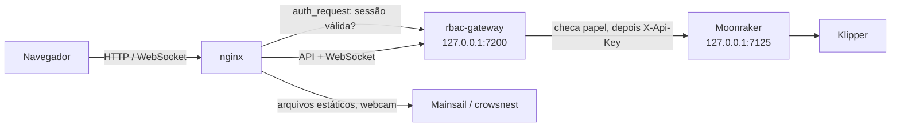

# Klipper RBAC Gateway

**Tela de login e controle de acesso por papéis para [Mainsail](https://github.com/mainsail-crew/mainsail) + [Moonraker](https://github.com/Arksine/moonraker) (Klipper).**

🇺🇸 [Read in English](README.md)

O Moonraker aceita usuários, mas qualquer usuário logado pode fazer tudo: editar o `printer.cfg`, rodar `SAVE_CONFIG`, reiniciar o firmware, atualizar o sistema. Já o Mainsail não tem tela de login para os usuários do Moonraker. Este projeto resolve as duas coisas com um pequeno gateway entre o nginx e o Moonraker:

- 🔐 **Tela de login antes do Mainsail carregar.** Sem sessão, nada fica acessível: nem o painel, nem a API, nem a webcam.
- 👥 **Três papéis** (`viewer`, `operator`, `admin`), aplicados em cada chamada de API e em cada mensagem do WebSocket.
- 🧩 **Aba "Users" dentro das Configurações de Interface do Mainsail** para admins: criar usuários, mudar papéis, excluir usuários.
- 🛡️ **Proteção do admin principal.** O primeiro admin nunca pode ser rebaixado nem excluído.
- 🧾 **Filtro de G-code.** Operadores só enviam pelo console comandos de uma lista permitida, e arquivos `.gcode` enviados são verificados em busca de comandos perigosos.
- 📜 **Registro de auditoria.** Todo login, ação negada e alteração de usuário fica no log.

O Mainsail **não é modificado**. Atualizar o Mainsail pelo update manager continua funcionando.

A interface (tela de login, aba Users, mensagens e linha de comando) está em inglês. Os papéis se chamam `viewer` (visitante), `operator` (operador) e `admin`.

---

## Sumário

- [Como funciona](#como-funciona)
- [Papéis](#papéis)
- [Requisitos](#requisitos)
- [Instalação](#instalação)
- [Uso](#uso)
- [Configuração](#configuração)
- [Personalizando permissões](#personalizando-permissões)
- [Segurança e limitações](#segurança-e-limitações)
- [Solução de problemas](#solução-de-problemas)
- [Desinstalar / voltar atrás](#desinstalar--voltar-atrás)
- [Estrutura do projeto](#estrutura-do-projeto)
- [Licença](#licença)

---

## Como funciona



1. O **nginx** pergunta ao gateway (`auth_request`), em *todo* acesso, se o navegador tem um cookie de sessão válido. Se não tiver, redireciona para `/_rbac/login`.
2. Depois do login, o Mainsail carrega normalmente. O tráfego de API e WebSocket vai para o gateway, em vez de ir direto ao Moonraker.
3. O **gateway** confere cada requisição HTTP e cada mensagem JSON-RPC contra o papel do usuário. O que é permitido segue para o Moonraker usando a API key do próprio Moonraker. O que é negado recebe erro `403`, que o Mainsail mostra como notificação.
4. O **Moonraker** escuta só em `127.0.0.1` e não confia em nenhum cliente, então ninguém na rede consegue contornar o gateway.
5. Um pequeno script (`ui.js`) é injetado pelo nginx (`sub_filter`) na página do Mainsail. Para admins ele acrescenta a aba **Users** nas Configurações de Interface; para todos, mostra quem criou cada arquivo/pasta na lista de G-codes.

Usuários, hashes de senha (scrypt) e sessões ficam no banco SQLite do próprio gateway. Os usuários do Moonraker não são usados.

## Papéis

| | Viewer | Operator | Admin |
|---|:---:|:---:|:---:|
| Ver temperaturas, progresso, webcam, histórico, arquivos | ✅ | ✅ | ✅ |
| Parada de emergência | ✅ | ✅ | ✅ |
| Iniciar / pausar / retomar / cancelar impressões | ❌ | ✅ | ✅ |
| Enviar arquivos e criar pastas em `gcodes/` | ❌ | ✅ | ✅ |
| Mover e apagar os **próprios** arquivos/pastas em `gcodes/` | ❌ | ✅ | ✅ |
| Mover e apagar arquivos/pastas de **qualquer um** | ❌ | ❌ | ✅ |
| Console / botões (só G-code da lista permitida) | ❌ | ✅ | ✅ |
| Qualquer G-code, macros fora da lista, `SAVE_CONFIG`, reinícios | ❌ | ❌ | ✅ |
| Editar `printer.cfg` e outros arquivos de configuração | ❌ | ❌ | ✅ |
| Atualizações, reiniciar/desligar, serviços | ❌ | ❌ | ✅ |
| Gerenciar usuários (aba Users) | ❌ | ❌ | ✅ |

A parada de emergência fica liberada para todos de propósito: qualquer pessoa olhando a impressora deve conseguir pará-la. Dá para mudar isso (veja [Personalizando permissões](#personalizando-permissões)).

## Requisitos

- Klipper + Moonraker + Mainsail servidos pelo **nginx**. O [MainsailOS](https://github.com/mainsail-crew/MainsailOS) funciona sem ajustes.
- Python **3.9+**.
- nginx com `ngx_http_auth_request_module` e `ngx_http_sub_module`. Os dois vêm no pacote nginx do Debian / Raspberry Pi OS.

Desenvolvido e testado no MainsailOS em um Raspberry Pi 4 (Python 3.13).

## Instalação

> **Antes de começar:** os passos 5 e 6 fecham o Moonraker. Mantenha uma sessão SSH aberta até confirmar que consegue entrar. [Voltar atrás](#desinstalar--voltar-atrás) leva segundos.

Os comandos abaixo supõem o usuário `pi` e o repositório em `~/klipper-rbac-gateway`. Ajuste se o seu for diferente.

### 1. Baixar e instalar as dependências

```bash
cd ~
git clone https://github.com/<seu-usuario-github>/klipper-rbac-gateway.git
cd klipper-rbac-gateway
python3 -m venv venv
venv/bin/pip install -r requirements.txt
```

### 2. Salvar a API key do Moonraker

Faça isto **antes** de fechar o Moonraker. Enquanto o Pi ainda é um cliente confiável do Moonraker, não precisa de credenciais.

```bash
venv/bin/python main.py apikey
```

O esperado é `API key saved to /home/pi/printer_data/gateway/api_key` (arquivo com permissão `600`).

### 3. Criar o primeiro admin (o admin principal)

```bash
venv/bin/python main.py create <seu-nome> admin
```

A senha é pedida duas vezes, e nada aparece enquanto você digita. **Esse primeiro admin vira o admin principal**: o papel dele nunca pode ser alterado e ele nunca pode ser excluído.

### 4. Instalar o serviço

```bash
sudo cp config/systemd/rbac-gateway.service /etc/systemd/system/
sudo systemctl daemon-reload
sudo systemctl enable --now rbac-gateway
journalctl -u rbac-gateway -n 5 --no-pager
```

O esperado é `Uvicorn running on http://127.0.0.1:7200`. Se o seu usuário não for `pi`, edite antes o `User=` e os caminhos no arquivo do serviço.

### 5. Fechar o Moonraker

Faça backup e edite o `~/printer_data/config/moonraker.conf`:

```bash
cp ~/printer_data/config/moonraker.conf ~/printer_data/config/moonraker.conf.bak
```

- Em `[server]`, defina `host: 127.0.0.1`.
- Em `[authorization]`, acrescente `force_logins: True` e **apague a lista `trusted_clients:` inteira**. Mantenha o `cors_domains`.

O resultado deve ficar assim:

```ini
[server]
host: 127.0.0.1
port: 7125
...

[authorization]
force_logins: True
cors_domains:
    ...
```

### 6. Apontar o nginx para o gateway

```bash
# backup da configuração do nginx
sudo cp -r /etc/nginx/conf.d /etc/nginx/conf.d.bak
SITE=$(readlink -f /etc/nginx/sites-enabled/mainsail)
sudo cp "$SITE" "$SITE.bak"

# 1) upstream de API/WebSocket -> gateway
sudo sed -i 's/127\.0\.0\.1:7125/127.0.0.1:7200/' /etc/nginx/conf.d/upstreams.conf

# 2) trecho de login + aba Users, incluído no topo do bloco server do Mainsail
sudo cp config/nginx/rbac-auth.conf /etc/nginx/rbac-auth.conf
sudo sed -i '0,/^\s*server\s*{/s//&\n    include \/etc\/nginx\/rbac-auth.conf;/' "$SITE"

sudo nginx -t
```

No MainsailOS o upstream fica em `/etc/nginx/conf.d/upstreams.conf`. Em outras instalações, encontre-o com `grep -rn 7125 /etc/nginx/`. Os upstreams das webcams (portas 8080 em diante) **não** devem ser alterados.

Se o `nginx -t` disser `test is successful`, aplique tudo:

```bash
sudo systemctl restart moonraker
sudo systemctl reload nginx
```

### 7. Conferir

```bash
curl -s http://127.0.0.1/access/info; echo            # -> "login_required":true,"trusted":false
curl -s http://127.0.0.1/_rbac/login | grep -o "_rbac/ui.js"   # -> _rbac/ui.js
```

Abra o Mainsail no navegador e aperte **Ctrl+F5**. A tela de login deve aparecer. Entre, abra as **Configurações de Interface** (ícone de engrenagem), e a aba **Users** fica no fim da lista.

## Uso

### Entrar e sair

- Página de login: `http://<impressora>/_rbac/login`. Qualquer página leva para lá quando não há sessão.
- Sair: `http://<impressora>/_rbac/logout`. O Mainsail não tem botão de sair, então vale salvar esse endereço nos favoritos.
- A sessão dura 7 dias por padrão (`RBAC_SESSION_DAYS`).

### Aba Users (só admins)

Em **Configurações de Interface → Users**:

- **New user** (no topo): usuário, senha, confirmação da senha e papel.
- **Tabela**: caixa de seleção, usuário e papel. Clicar no papel abre uma janela de confirmação para alterá-lo. A mudança vale na hora, inclusive para quem já está conectado.
- **Delete user** (embaixo): só fica ativo com pelo menos um usuário marcado. Pede confirmação e encerra as sessões dos usuários excluídos.

Proteções:

- O **admin principal** (🔒) não pode ser rebaixado nem excluído, nem por outros admins.
- Ninguém consegue mudar o próprio papel nem excluir a si mesmo, para ninguém se trancar para fora sem querer.

### Linha de comando

Rode de dentro da pasta do repositório:

```bash
venv/bin/python main.py list                    # lista usuários (marca o admin principal)
venv/bin/python main.py create <usuario> <papel> # papel: viewer | operator | admin
venv/bin/python main.py passwd <usuario>        # troca a senha (encerra as sessões dele)
venv/bin/python main.py role <usuario> <papel>
venv/bin/python main.py remove <usuario>
venv/bin/python main.py apikey                  # busca de novo a API key do Moonraker
```

A linha de comando funciona mesmo se ninguém conseguir entrar pelo navegador, e é o jeito de recuperar uma senha esquecida.

### Dono dos arquivos

Todo arquivo ou pasta criado pelo gateway (upload, nova pasta, cópia) fica registrado com o usuário que o criou. A lista de G-codes do Mainsail mostra esse nome ao lado de cada item (destacado quando é seu).

- **Operadores** só apagam ou movem o que eles mesmos criaram. No caso de uma pasta, tudo dentro dela também precisa ser deles. Também não podem sobrescrever (enviar, mover ou copiar por cima) um item criado por outra pessoa.
- **Admins** apagam ou movem qualquer coisa.
- Itens sem dono registrado (anteriores a este recurso, ou criados fora do gateway por SSH, Samba, upload do fatiador direto no Moonraker...) aparecem como **no record** e só o admin pode apagá-los.

Para atribuir um arquivo ou pasta já existente a um usuário pela linha de comando:

```bash
venv/bin/python main.py owner gcodes/Testes joao        # uma pasta (só a pasta em si)
venv/bin/python main.py owner gcodes/peca.gcode joao    # um arquivo
```

Os donos ficam na tabela `owners` do `rbac.db`. Remover um usuário mantém os registros, então os arquivos dele passam a ser só do admin.

## Configuração

As configurações vêm de variáveis de ambiente. Defina-as com linhas `Environment=` no arquivo do serviço e depois rode `sudo systemctl daemon-reload && sudo systemctl restart rbac-gateway`.

| Variável | Padrão | Descrição |
|---|---|---|
| `RBAC_MOONRAKER_URL` | `http://127.0.0.1:7125` | Onde o Moonraker escuta |
| `RBAC_DATA_DIR` | `~/printer_data/gateway` | Pasta do banco (`rbac.db`) e da API key |
| `RBAC_PRINTER_DATA` | `~/printer_data` | Pasta com as raízes do Moonraker (`gcodes/`, ...), usada para conferir o conteúdo das pastas no controle de dono |
| `RBAC_SESSION_DAYS` | `7` | Duração da sessão |
| `RBAC_SECURE_COOKIE` | `0` | Use `1` quando servir por HTTPS |
| `RBAC_LOGIN_TITLE` | `3D Printer` | Título da página de login |

O gateway em si escuta só em `127.0.0.1:7200`. Essa porta é definida no arquivo do serviço e no `rbac-auth.conf`.

## Personalizando permissões

As permissões são listas simples no topo do `main.py`. Reinicie o serviço depois de editar.

| Lista | O que controla |
|---|---|
| `READ_RPC` | Métodos do Moonraker liberados para todos (base do viewer) |
| `OPERATOR_RPC` | Métodos extras do operador |
| `OPERATOR_GCODE` | Comandos que o operador pode mandar pelo console/botões |
| `BLOCKED_IN_FILES` | Comandos recusados dentro de arquivos `.gcode` enviados por não-admins |
| `COMMON_HTTP` | Rotas HTTP para qualquer usuário logado |
| `ROLES[...]["http"]` | Rotas HTTP por papel, no formato `"MÉTODO /caminho"` com curingas |
| `ROLES[...]["writable_roots"]` | Pastas onde cada papel pode escrever |

Os padrões usam curingas no estilo do shell (`printer.print.*`, `GET /server/files/gcodes/*`).

**Dica:** tudo o que o gateway bloqueia vai para o log. Acompanhe enquanto usa o Mainsail com um usuário restrito e acrescente o que for legítimo:

```bash
journalctl -u rbac-gateway -f | grep DENIED
```

Acréscimos comuns: suas próprias macros (por exemplo `PRINT_START`, se operadores a rodam na mão), `machine.device_power.*` para dispositivos de energia, `server.spoolman.*` para o Spoolman.

## Segurança e limitações

- **Macros são confiáveis.** Liberar uma macro para operadores libera tudo o que ela faz por dentro. O filtro só enxerga o nome do comando.
- **Arquivos G-code** enviados por não-admins são verificados contra o `BLOCKED_IN_FILES`. Arquivos que já estavam na impressora não passam por essa verificação.
- **O Mainsail continua mostrando todos os botões.** Usuários restritos veem os botões, e ao clicar recebem um erro de permissão.
- **A injeção da aba depende do layout do Mainsail.** Se uma versão futura do Mainsail mudar a janela de Configurações de Interface, a aba Users pode não aparecer. O login e as permissões continuam funcionando, e a linha de comando continua gerenciando usuários.
- **Configurações de interface compartilhadas.** O Mainsail guarda as configurações dele no banco do Moonraker (namespace `mainsail`), compartilhado entre todos. Viewers não conseguem alterá-las. Operadores e admins conseguem.
- **Use HTTPS ou VPN para acesso remoto.** O cookie de sessão é `HttpOnly` e `SameSite=Lax`, mas HTTP puro pode ser interceptado em redes não confiáveis. Recomenda-se Tailscale, ou um proxy reverso com TLS mais `RBAC_SECURE_COOKIE=1`.
- **Força bruta.** Logins que falham esperam 1,5 s e são registrados com o IP. Para expor à internet, acrescente fail2ban ou limite de requisições no nginx.
- **Efeitos colaterais de fechar o Moonraker:**
  - A porta `7125` deixa de ser acessível pela rede. Slicers que enviam arquivos direto para `:7125` precisam usar a porta 80 com a API key do Moonraker (`X-Api-Key`), que dá acesso de admin.
  - Clientes locais como o KlipperScreen precisam ser configurados com a API key.

## Solução de problemas

| Sintoma | Causa / solução |
|---|---|
| O Mainsail mostra *"Connection failed — Unauthorized"* em vez da tela de login | O nginx não está usando o trecho do gateway. Confira a linha `include` no site do Mainsail e rode `sudo nginx -t`. |
| A página de login volta para ela mesma | O cookie não está sendo gravado. Se você usou `RBAC_SECURE_COOKIE=1`, precisa estar em HTTPS. |
| `gateway has no Moonraker API key` | Rode `venv/bin/python main.py apikey` e reinicie o serviço. Repita sempre que a API key for regenerada no Moonraker. |
| Um botão falha com *"… is not allowed for role …"* | Está funcionando como deveria, ou falta o método em alguma lista. Veja `journalctl -u rbac-gateway \| grep DENIED`. |
| A aba Users não aparece | Só admins a veem. Confirme que o script está sendo injetado (`curl -s http://127.0.0.1/_rbac/login \| grep ui.js`), aperte Ctrl+F5 e olhe o console do navegador (F12). |
| Esqueci uma senha | `venv/bin/python main.py passwd <usuario>` |
| O serviço fica reiniciando | `journalctl -u rbac-gateway -n 50 --no-pager` |

## Desinstalar / voltar atrás

```bash
# nginx: remove o trecho e restaura o upstream
SITE=$(readlink -f /etc/nginx/sites-enabled/mainsail)
sudo cp "$SITE.bak" "$SITE"
sudo sed -i 's/127\.0\.0\.1:7200/127.0.0.1:7125/' /etc/nginx/conf.d/upstreams.conf
sudo systemctl reload nginx

# Moonraker: restaura a configuração anterior
cp ~/printer_data/config/moonraker.conf.bak ~/printer_data/config/moonraker.conf
sudo systemctl restart moonraker

# gateway
sudo systemctl disable --now rbac-gateway
sudo rm /etc/systemd/system/rbac-gateway.service /etc/nginx/rbac-auth.conf
sudo systemctl daemon-reload
```

Os dados de usuários ficam em `~/printer_data/gateway/`. Apague essa pasta para removê-los.

## Estrutura do projeto

```
klipper-rbac-gateway/
├── main.py                      # gateway: login, sessões, permissões, proxy, API de usuários, CLI
├── ui.js                        # aba "Users" (admins) e nome do dono dos arquivos, injetados no Mainsail
├── requirements.txt
├── config/
│   ├── nginx/rbac-auth.conf     # trecho do nginx (auth_request + injeção do script)
│   └── systemd/rbac-gateway.service
├── README.md
├── README.pt-BR.md
└── LICENSE
```

## Licença

[GNU General Public License v3.0](LICENSE).

Este projeto não tem relação oficial com o Klipper, o Moonraker ou o Mainsail.
